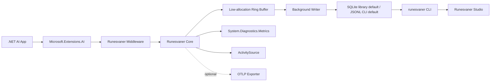

# Runesvaner

> **Status: M1 complete — M2 cost engine in progress.**
> Completed: Microsoft.Extensions.AI chat decorator, streaming ITL/TPS/chunk stats, cancellation/error tests, JSONL/SQLite storage, CLI `report`/`doctor`/`costs`/`pricing`, RAG sample, benchmark baseline, cost engine core, price table loader, OpenTelemetry exporter, Studio cost view + request waterfall + session browser + compare view, GitHub Pages docs site, 21 tests, Windows/Linux CI, Windows Native AOT smoke.
> Next: verified built-in price snapshot, performance gates, NuGet placeholder.
>
> Repository: https://github.com/karlmoriaty/runesvaner
> English is the source of truth. Chinese legacy full translation: [`docs/zh-Hans/README.md`](docs/zh-Hans/README.md).

**See every millisecond and every cent of an AI request.**

Runesvaner is an in-process performance and cost profiler for .NET AI applications. It breaks a single LLM call, embedding request, or vector search into an explainable **latency waterfall** and a **cost ledger**, while remaining usable under Native AOT, trimming, and local-first constraints.

---

## Why it exists

.NET already has strong general diagnostics: `dotnet-trace`, `dotnet-counters`, `dotnet-dump`, and OpenTelemetry. But AI workloads fail in different places:

- A RAG request takes 8 seconds. Is the time in embedding, vector search, network, time-to-first-token, generation, serialization, or retries?
- The monthly LLM bill tripled. Which feature, tenant, model, or prompt version caused it?
- Streaming feels slow. Is the delay in connect, upload, provider queueing, or the first token?
- Did retries cause duplicate billing? How much did prompt caching actually save?
- The service is deployed with Native AOT. Do the existing diagnostics still work?

General APM says "this span is slow." Runesvaner answers "which segment, which cost item, and what to change next."

## What it does

| Capability | Description |
| --- | --- |
| Latency breakdown | Queue / Auth / Connect / TLS / Upload / Provider queue / TTFT / Generation / Tool / Vector / Serialization / Retry / Unaccounted |
| Cost ledger | Input / output / cached / reasoning / image / audio tokens, versioned price tables, cache and batch discounts, retry duplicate-billing checks |
| Streaming analysis | TTFT, inter-token latency, tokens/s, stream interruption, cancellation, partial responses |
| Attribution | Tenant / user hash / feature / prompt version / model / provider / endpoint |
| Local first | Library default SQLite; AOT CLI default JSONL; fallback on failure; no prompt/completion content by default |
| AOT safe | Core libraries use no reflection or dynamic code, `IsAotCompatible`; CLI targets Native AOT |
| Interoperability | Optional OTLP export; Langfuse, Phoenix, and Grafana are optional validation targets, not compatibility guarantees |

## Current implementation (M1)

| Capability | Status |
| --- | --- |
| Microsoft.Extensions.AI chat decorator (non-streaming) | Implemented |
| Streaming metrics | Chunk count, TTFT, ITL P50/P95, TPS when usage is available, finish reason |
| Recorder + JSONL storage | Implemented |
| SQLite storage | Basic writes implemented |
| CLI `report` / `doctor` | Implemented |
| RAG sample | Implemented |
| Benchmark baseline | Recorded (mean 324.9 ns, P95 3.70 us) |
| Cost engine core | Implemented (price table, cached/reasoning/batch/unknown) |
| Price table loader + `costs` | Implemented (JSON schema, aliases, validation, aggregation) |
| OpenTelemetry exporter | Optional package: spans/metrics + OTLP SDK; tested with listeners |
| Studio cost view | Read-only API + React 19/RTK Query page; loopback + token |
| Studio request detail | Latency waterfall, cost breakdown, stream metrics, tags |
| Session browser + query store | SQLite/JSONL query contract, session summaries, request filtering |
| Studio compare | Side-by-side waterfalls and duration/cost/token/ITL/TPS deltas |
| DI extensions, Studio, OTLP | Not implemented |

## What it is not

- Not a general CPU/memory profiler; it does not replace `dotnet-trace` or PerfView.
- Not a replacement for Langfuse or Phoenix; it is a .NET-side front-end profiler for them.
- Not an LLM evaluation or prompt experiment platform (v1 has no eval).
- Not a proxy or gateway; it does not forward or rewrite requests.
- Does not capture prompt content by default and never uploads silently.

## Build and run

Requirements: .NET SDK `10.0.404+`, Windows 10/11 or Linux.

    dotnet build Runesvaner.sln -c Release
    dotnet test Runesvaner.sln -c Release

Run the minimal sample (local mock chat client, no real provider):

    dotnet run --project samples/Runesvaner.Sample.Console -c Release
    dotnet run --project samples/Runesvaner.Sample.Rag -c Release
    dotnet run --project src/Runesvaner.Cli -c Release -- report
    dotnet run --project src/Runesvaner.Cli -c Release -- pricing validate --path pricing/example-prices.json
    dotnet run --project src/Runesvaner.Cli -c Release -- costs

Studio:

    npm ci --prefix src/Runesvaner.Studio.UI
    npm run build --prefix src/Runesvaner.Studio.UI
    dotnet run --project src/Runesvaner.Studio -c Release

`report` reads `.runesvaner/sessions/*.jsonl` and prints request count, model, duration, TTFT, and status.

The library/app default store is SQLite. The sample and AOT CLI use JSONL to reduce native dependencies. On SQLite initialization failure the target behavior is an automatic JSONL fallback (M1 follow-up).

Current integration shape:

    var store = new JsonlRunesvanerStore(".runesvaner");
    var recorder = new RunesvanerRecorder(store, new RunesvanerOptions
    {
        ApplicationName = "support-api",
        StorageMode = StorageMode.Jsonl
    });

    var client = new RunesvanerChatClient(innerChatClient, recorder);

> M1 does not yet expose DI extensions or full `UseRunesvaner()` configuration overloads. The target API is documented in `docs/07-api-design.md`.

Native AOT:

    dotnet publish samples/Runesvaner.Sample.Aot -c Release -r win-x64 --self-contained true

Local Windows publishing requires the Visual Studio Desktop development with C++ workload (linker). CI covers the AOT smoke.

## Target architecture (M1 implements only the minimal path)

Design principles:

1. **Business requests first**: a collector failure must never fail a business request.
2. **Zero-dependency core**: `Runesvaner.Abstractions` and `Runesvaner` do not depend on the OpenTelemetry SDK.
3. **AOT first-class**: no reflection, `Assembly.Load`, or `Reflection.Emit` in core paths.
4. **No content by default**: content capture is explicit and local by default.
5. **Explainable estimates**: unmeasurable intervals are marked `estimated`, not presented as exact.

## Support matrix (planned/actual)

| Area | M1 | M2 | 1.0 |
| --- | --- | --- | --- |
| TFM | `net10.0` | `net10.0` | `net10.0`; evaluate `net11.0` |
| AI abstraction | Microsoft.Extensions.AI 10.11.1 | + Semantic Kernel | + Microsoft.Extensions.VectorData |
| Storage | SQLite (library default) | JSONL (CLI AOT default/fallback) | + read-only import |
| Export | None | OTLP (optional package) | OTLP validation; third-party compatibility on demand |
| AOT | Core analyzers + Windows CI smoke | CLI AOT publish | Windows/Linux matrix |
| OS | Windows 10/11 / Linux | Windows / Linux | Windows / Linux (macOS non-goal) |

## Documentation

English is the source of truth. The Chinese legacy full translation lives in [`docs/zh-Hans/`](docs/zh-Hans/README.md).

| Document | Content |
| --- | --- |
| [Project charter](docs/00-project-charter.md) | Vision, scope, success metrics, kill criteria |
| [Market and competitor research](docs/01-market-research.md) | Evidence, competitors, two-slice scoring, conclusion |
| [Problem and personas](docs/02-problem-and-personas.md) | Pain points, JTBD, journey, objections |
| [PRD](docs/03-prd.md) | Functional requirements, acceptance criteria, NFRs |
| [UI/UX and visual design](docs/04-ux-and-visual-design.md) | Design language, color, layout, components, logo |
| [Technical design](docs/05-technical-design.md) | Architecture, modules, threading, overhead, cost engine |
| [Observability model](docs/06-observability-model.md) | Segments, metrics, cost model, schema |
| [Public API design](docs/07-api-design.md) | C# interfaces, DI, options, extension points |
| [Native AOT strategy](docs/08-native-aot-strategy.md) | Constraints, matrix, CI, size budgets |
| [Security and privacy](docs/09-security-privacy.md) | Threat model, capture, retention, Studio security |
| [Open-source governance](docs/10-open-source-governance.md) | License, CLA, governance, release |
| [Roadmap](docs/11-roadmap.md) | M0–M4 and v2 |
| [Testing and benchmarks](docs/12-testing-and-benchmarks.md) | Test pyramid, performance gates |
| [Benchmark baseline](docs/benchmarks-baseline.md) | Recorder mean/P95, environment, caveats |
| [Pricing data](pricing/README.md) | Price table schema, validation, illustrative sample |
| [OTel exporter](src/Runesvaner.Exporters.OpenTelemetry/README.md) | Optional OTLP signal exporter and usage |
| [Studio](src/Runesvaner.Studio/README.md) | Local cost ledger UI, API, security model |
| [Documentation site](https://karlmoriaty.github.io/runesvaner/) | Published English design docs (GitHub Pages) |
| [Risk register](docs/13-risk-register.md) | 24 risks and mitigations |
| [Hidden requirements](docs/14-hidden-requirements.md) | 60 overlooked product/engineering requirements |
| [Decision log](docs/15-decision-log.md) | D-01 to D-25 decisions |
| [Brand naming](docs/16-brand-naming.md) | Runesvaner naming, availability, trademark status |
| [Docs and community](docs/17-docs-and-community.md) | Docs site, contributors, release cadence |
| [Localization scope](docs/18-localization-scope.md) | English complete; Chinese/German core summaries |
| [Implementation decisions](docs/19-open-implementation-decisions.md) | D-23–D-25 records |

## Roadmap

| Milestone | Theme | Exit criteria |
| --- | --- | --- |
| M0 | Design freeze | Done: D-01–D-25 decisions, governance files, solution skeleton |
| M1 | Walking Skeleton | Complete: RAG sample, benchmark baseline, 13 tests, Windows/Linux CI, Windows AOT smoke; SQLite AOT remains documented fallback |
| M2 | MVP | In progress: cost engine + price loader + `costs` + streaming stats + OTel exporter + Studio cost/waterfall/session/compare views + Pages docs done; performance gates |
| M3 | Beta | Semantic Kernel, VectorData, tail sampling, budgets, docs site |
| M4 | 1.0 | Stable public API, performance/security audit, CLA workflow effective |

## Contributing

This is a personal open-source project, not affiliated with any organization. The project uses **Apache-2.0 + ICLA/CCLA** (D-03/D-04). The CLA text is not yet effective, so external pull requests are not accepted; please discuss larger changes in an Issue first.

## License

Apache License 2.0. See `LICENSE` and `NOTICE`.