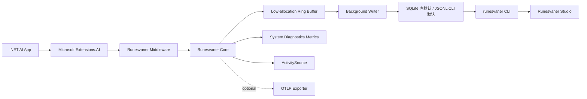

# Runesvaner

> **Status: M1 Walking Skeleton — 最小端到端路径与 AOT smoke 已通过。**
> 已完成：Microsoft.Extensions.AI Chat 装饰器、JSONL/SQLite 基础存储、CLI `report`/`doctor`、5 个测试、Windows/Linux CI + Windows Native AOT smoke。
> 未完成：RAG sample、基准基线、成本引擎、完整流式指标、Studio、OTLP 导出。
>
> 仓库：https://github.com/karlmoriaty/runesvaner

**看见一次 AI 请求的每一毫秒和每一分钱。**

Runesvaner 是一个面向 .NET AI 应用的进程内性能与成本剖析器。它把一次 LLM 调用、Embedding 生成或向量检索拆解成可解释的**延迟瀑布**与**成本账单**，并保证在 Native AOT、Trimming 和本地优先的约束下仍然可用。

---

## 为什么需要它

.NET 已经有很强的通用诊断工具链：`dotnet-trace`、`dotnet-counters`、`dotnet-dump`、OpenTelemetry。但 AI 负载的诊断问题不是"进程 CPU 高不高"，而是：

- 一次 RAG 请求耗时 8 秒，时间到底花在 Embedding、向量检索、网络、首 Token、生成、序列化，还是重试？
- 这个月 LLM 账单涨了 3 倍，是哪个功能、哪个租户、哪个模型、哪个 Prompt 版本造成的？
- 流式响应的首字为什么慢？是连接、上传、Provider 排队，还是首 Token 本身？
- 重试是否造成了重复计费？缓存命中到底省了多少钱？
- 服务用 Native AOT 部署后，现有的诊断手段还能用吗？

通用 APM 能告诉你"这个 Span 很慢"，但很少告诉你"慢在哪一段、贵在哪一项、下一次该改什么"。Runesvaner 专注这一条缝隙。

## 它做什么

| 能力 | 说明 |
| --- | --- |
| 延迟分解 | 把请求拆成 Queue / Auth / Connect / TLS / Send / Wait / TTFT / Generation / Tool / Vector / Serialization / Retry / Unaccounted |
| 成本账本 | 按 Input / Output / Cached / Reasoning / Image / Audio Token 计费，价格表版本化，支持缓存折扣、批量折扣与重试重复计费检测 |
| 流式剖析 | TTFT、Token 间延迟、Tokens/s、流中断、取消、部分响应 |
| 归因维度 | Tenant / User hash / Feature / Prompt version / Model / Provider / Endpoint |
| 本地优先 | 库默认 SQLite；AOT CLI 默认 JSONL；失败回退。不采集 Prompt 与 Completion 正文 |
| AOT 安全 | 核心库零反射、零动态代码，`IsAotCompatible`，CLI 以 Native AOT 发布 |
| 标准互操作 | 可选 OTLP 导出；Langfuse、Phoenix、Grafana 为可选验证目标，不承诺全量兼容 |

## 当前实现状态（M1）

| 能力 | 状态 |
| --- | --- |
| Microsoft.Extensions.AI Chat 装饰器（非流式） | 已实现 |
| 流式 TTFT 记录 | 已实现基础路径 |
| 记录器 + JSONL 存储 | 已实现 |
| SQLite 存储 | 已实现基础写入 |
| CLI `report` / `doctor` | 已实现 |
| DI 扩展、成本引擎、Studio、OTLP | 未实现 |

## 它不是什么

- 不是通用 CPU / 内存 Profiler，不替代 `dotnet-trace` 与 PerfView。
- 不是 Langfuse / Phoenix 的替代品，而是它们的 .NET 侧"前置剖析器"。
- 不是 LLM 评估或 Prompt 实验平台（v1 不做 Eval）。
- 不是代理网关，不转发、不改写请求。
- 不默认采集 Prompt 内容，不做"悄悄上传"。

## 构建与运行（M1）

前置条件：.NET SDK `10.0.404+`，Windows 10/11 或 Linux。

    dotnet build Runesvaner.sln -c Release
    dotnet test Runesvaner.sln -c Release

运行最小示例（本地 mock ChatClient，不调用真实 provider）：

    dotnet run --project samples/Runesvaner.Sample.Console -c Release
    dotnet run --project src/Runesvaner.Cli -c Release -- report

`report` 读取 `.runesvaner/sessions/*.jsonl`，输出请求数、模型、耗时、TTFT 与状态。

库/应用内默认存储为 SQLite；示例与 AOT CLI 为降低原生依赖使用 JSONL。SQLite 初始化失败时目标行为是自动回退 JSONL（M1 后续完善）。

接入代码的当前形态：

    var store = new JsonlRunesvanerStore(".runesvaner");
    var recorder = new RunesvanerRecorder(store, new RunesvanerOptions
    {
        ApplicationName = "support-api",
        StorageMode = StorageMode.Jsonl
    });

    var client = new RunesvanerChatClient(innerChatClient, recorder);

> M1 尚未提供 DI 扩展与 `UseRunesvaner()` 的完整配置重载；以 `docs/07-api-design.md` 为目标 API，逐步实现。

Native AOT：

    dotnet publish samples/Runesvaner.Sample.Aot -c Release -r win-x64 --self-contained true

Windows 本地发布需要 Visual Studio 的 Desktop development with C++ workload（链接器）；缺失时会在链接阶段报错。CI 将覆盖 AOT smoke。

## 目标架构（M1 只实现最小路径）

设计原则：

1. **业务请求优先**：采集链路任何故障都不能让业务请求失败。
2. **零依赖核心**：`Runesvaner.Abstractions` 与 `Runesvaner` 不依赖 OpenTelemetry SDK。
3. **AOT 一等公民**：核心路径不使用反射、`Assembly.Load`、`Reflection.Emit`。
4. **默认不采集内容**：内容捕获必须显式开启，且默认仅本地。
5. **可解释的估算**：无法精确测量的时间段标记为 `estimated`，不伪装成精确值。

## 支持矩阵（计划）

| 维度 | M1 | M2 | 1.0 |
| --- | --- | --- | --- |
| TFM | `net10.0` | `net10.0` | `net10.0`；评估 `net11.0` |
| AI 抽象 | Microsoft.Extensions.AI | + Semantic Kernel | + Microsoft.Extensions.VectorData |
| 存储 | SQLite（库默认） | JSONL（CLI AOT 默认/回退） | + 只读导入 |
| 导出 | 无 | OTLP（可选包） | OTLP 验证；第三方兼容按需 |
| AOT | 核心库分析 + Smoke | CLI AOT 发布 | Windows/Linux 全矩阵 AOT 回归 |
| OS | Windows 10/11 / Linux | Windows / Linux | Windows / Linux（macOS 非目标） |

## 文档索引

| 文档 | 内容 |
| --- | --- |
| [项目章程](docs/00-project-charter.md) | 愿景、范围、成功指标、终止条件 |
| [市场与竞品调研](docs/01-market-research.md) | 两个切口的证据、竞品数据、结论 |
| [问题与用户画像](docs/02-problem-and-personas.md) | 痛点、JTBD、用户旅程、异议处理 |
| [产品需求文档](docs/03-prd.md) | 功能需求、验收标准、非功能需求 |
| [UI/UX 与视觉规范](docs/04-ux-and-visual-design.md) | 设计语言、色彩、布局、组件、Logo |
| [技术设计](docs/05-technical-design.md) | 架构、模块、线程模型、开销预算 |
| [遥测数据模型](docs/06-observability-model.md) | Span、指标、成本模型、语义约定 |
| [公共 API 设计](docs/07-api-design.md) | C# 接口、DI、配置、兼容性 |
| [Native AOT 策略](docs/08-native-aot-strategy.md) | 约束、验证矩阵、风险 |
| [安全与隐私](docs/09-security-privacy.md) | 威胁模型、内容捕获、保留策略 |
| [开源治理](docs/10-open-source-governance.md) | License、CLA、行为准则、发布 |
| [路线图](docs/11-roadmap.md) | M0–M4 退出标准 |
| [测试与基准](docs/12-testing-and-benchmarks.md) | 测试金字塔、性能门槛、AOT 回归 |
| [风险登记册](docs/13-risk-register.md) | 风险、概率、影响、缓解 |
| [隐形需求清单](docs/14-hidden-requirements.md) | 容易被忽略的产品与工程需求 |
| [决策文档](docs/15-decision-log.md) | D-01 至 D-25 决议记录 |
| [命名调研](docs/16-brand-naming.md) | Runesvaner 命名规范、可用性初筛、商标待办 |
| [文档与社区运营](docs/17-docs-and-community.md) | 文档站、贡献者体验、发布节奏 |
| [本地化范围](docs/18-localization-scope.md) | 英文全量、中文/德语核心简版、术语表 |
| [实施级决议](docs/19-open-implementation-decisions.md) | D-23–D-25 决议记录 |

## 路线图

| 里程碑 | 主题 | 退出标准 |
| --- | --- | --- |
| M0 | 设计冻结 | 已完成：D-01–D-25 决议、治理文件、解决方案骨架 |
| M1 | Walking Skeleton | 进行中：端到端路径、5 个测试、Windows/Linux CI、Windows AOT smoke 已通过；RAG sample 与基准基线待补 |
| M2 | MVP | 成本引擎、流式指标、Studio、OTLP 导出、基准达标 |
| M3 | Beta | Semantic Kernel、VectorData、尾采样、预算告警、文档站 |
| M4 | 1.0 | 公共 API 稳定、性能与安全审计完成、CLA 流程可用 |

## 参与贡献

项目为个人开源项目，非隶属任何组织。已决议采用 **Apache-2.0 + ICLA/CCLA**（D-03/D-04）。CLA 文本尚未生效，外部 PR 暂不接受；请先通过 Issue 讨论较大改动。

## 许可证

使用 Apache License 2.0，见根目录 `LICENSE` 与 `NOTICE`。